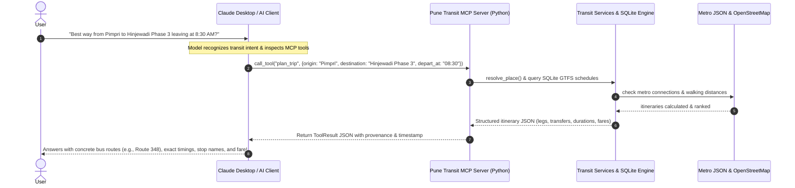
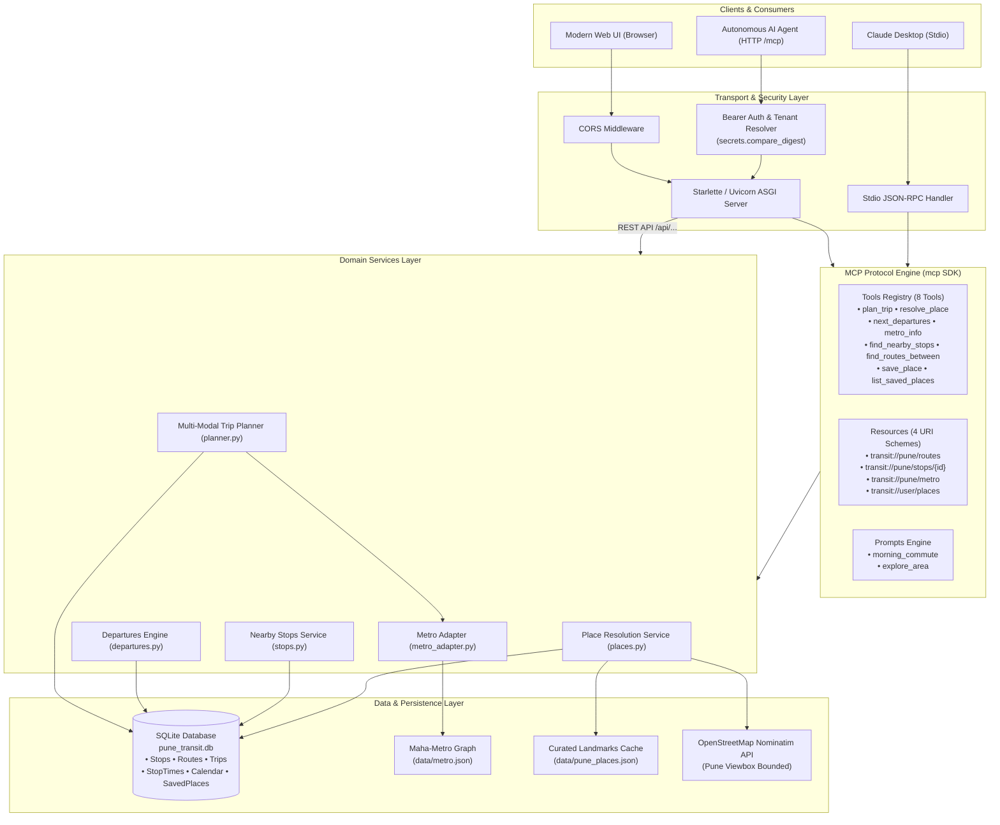
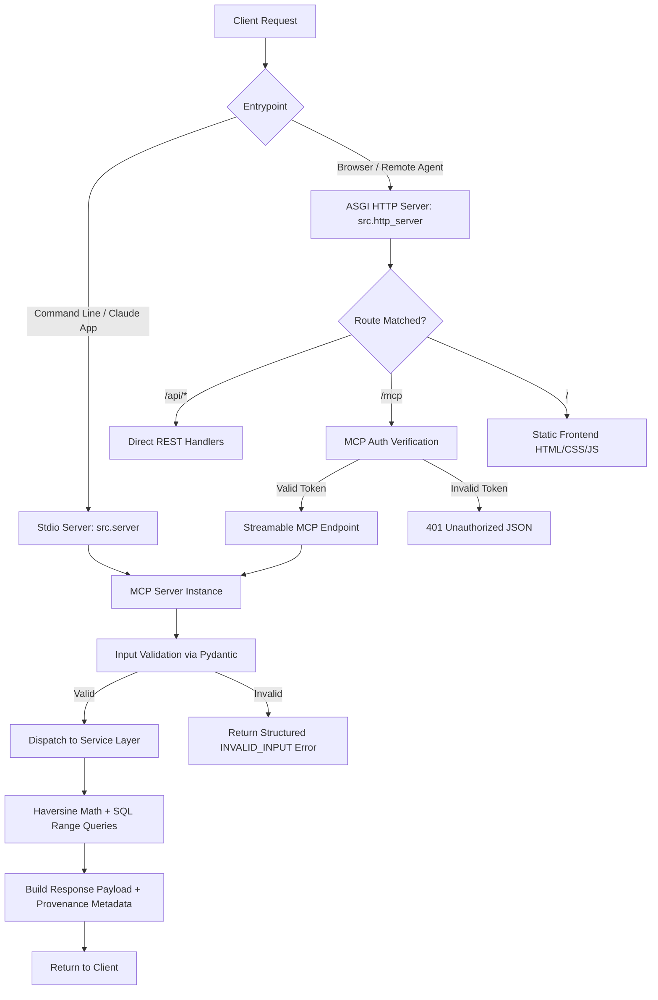

# 🚌 Pune Transit & Commute MCP Server

[](https://www.python.org/downloads/)
[](https://modelcontextprotocol.io)
[](#testing)
[](https://www.starlette.io/)
[](./LICENSE)
[](https://github.com/shreyashhiray16/MCP-.git)

An enterprise-grade **Model Context Protocol (MCP)** server and full-featured interactive web application providing ground-truth transit intelligence for the **Pune & Pimpri-Chinchwad Metropolitan Region**.

It integrates **PMPML bus schedules (GTFS)**, the complete **Pune Metro network (Maha-Metro Purple & Aqua lines)**, intelligent geocoding, multi-modal trip planning, and tenant-isolated personal place bookmarks into an AI-ready context layer for LLMs like Claude, ChatGPT, and custom AI agents.

---

## 📑 Table of Contents

- [Overview & Problem Statement](#overview--problem-statement)
- [How MCP Works in this Project](#how-mcp-works-in-this-project)
- [System Architecture](#system-architecture)
  - [High-Level Architecture Diagram](#high-level-architecture-diagram)
  - [Detailed Request & Execution Flow](#detailed-request--execution-flow)
- [Core Functionalities & Features](#core-functionalities--features)
  - [1. Multi-Modal Trip Planning](#1-multi-modal-trip-planning)
  - [2. Next Departures & Timetable Intelligence](#2-next-departures--timetable-intelligence)
  - [3. Pune Metro Engine](#3-pune-metro-engine)
  - [4. Stop Discovery & Spatial Geocoding](#4-stop-discovery--spatial-geocoding)
  - [5. Personalized Saved Places](#5-personalized-saved-places)
  - [6. Interactive Web Application](#6-interactive-web-application)
- [MCP Specification Details](#mcp-specification-details)
  - [MCP Tools (8 Tools)](#mcp-tools-8-tools)
  - [MCP Resources (4 Resources)](#mcp-resources-4-resources)
  - [MCP Prompts (2 Prompts)](#mcp-prompts-2-prompts)
- [REST API Endpoints](#rest-api-endpoints)
- [Installation & Quickstart](#installation--quickstart)
- [Connecting with Claude Desktop](#connecting-with-claude-desktop)
- [Inspecting with MCP Inspector](#inspecting-with-mcp-inspector)
- [Production & Docker Deployment](#production--docker-deployment)
- [Testing & Quality Assurance](#testing--quality-assurance)
- [Directory Structure](#directory-structure)
- [Contributing & License](#contributing--license)

---

## 🌟 Overview & Problem Statement

Commuting across Pune and Pimpri-Chinchwad presents unique challenges:
- High road traffic congestion between key IT corridors (Hinjewadi, Magarpatta, Kharadi, Yerwada).
- Mixed transit options across **PMPML city buses**, **Pune Metro (Line 1 Purple, Line 2 Aqua)**, suburban rail, and walking legs.
- Large Language Models (LLMs) frequently **hallucinate** bus route numbers, stop sequences, operational hours, and transit fares when answering without tool augmentation.

**The Pune Transit MCP Server eliminates hallucination** by giving LLMs real-time tool calls and grounded knowledge primitives backed by:
1. **SQLite GTFS database** with spatial bounding-box indexing.
2. **Official Maha-Metro network data** with station graph, transfer hubs (Civil Court), and tiered fare logic.
3. **Hybrid Geocoding**: Offline Pune landmark alias dictionary + OpenStreetMap Nominatim with viewbox restriction.
4. **Tenant Isolation**: Multi-user saved place preferences (`home`, `office`, `gym`) backed by secure authentication.

---

## 🔌 How MCP Works in this Project

The **Model Context Protocol (MCP)** is an open standard that allows AI assistants (such as Claude Desktop, IDE extensions, or agent workflows) to securely discover and execute tools, read structured resources, and use system prompts exposed by local or remote servers.



### Key Protocol Highlights:
- **Dual Transport Support**:
  - **Stdio (`src.server`)**: Direct process pipes with strict JSON-RPC communication on `stdin`/`stdout`. All logs safely piped to `stderr` to avoid JSON protocol corruption.
  - **Streamable HTTP (`src.http_server`)**: Mounted at `/mcp` over HTTP/HTTPS with Bearer Token validation and tenant separation.
- **Self-Correcting Structured Errors**: When a user inputs an ambiguous location like *"Hinjewadi"*, the server does not guess. It responds with an `AMBIGUOUS_PLACE` error with candidates (*Phase 1, Phase 2, Phase 3*), enabling Claude to prompt the user for clarification.

---

## 🏗️ System Architecture

### High-Level Architecture Diagram



### Detailed Request & Execution Flow



---

## 🚀 Core Functionalities & Features

### 1. Multi-Modal Trip Planning
- **Direct Bus Trips**: Identifies non-stop PMPML bus services between origin and destination stops.
- **One-Transfer Bus Connections**: Discovers optimal transfer junctions (e.g., Swargate, Shivajinagar, Manapa Bhavan) with sensible layover buffers (5–45 minutes).
- **Metro Trips**: Computes metro routes including transfers at **Civil Court** (interchange between Purple and Aqua lines).
- **Walking Legs**: Computes walking segments between origin/destination coordinates and transit stops using Haversine distance.
- **Road Comparison**: Estimates cab/auto road travel times and fares for clear comparison against public transit.

### 2. Next Departures & Timetable Intelligence
- **Seconds-from-Midnight Indexing**: Handles after-midnight transit trips (e.g. `24:15:00` or `25:30:00`) seamlessly without datetime wrapping errors.
- **Calendar & Service Day Filtering**: Evaluates active day schedules (`Monday`–`Sunday`) against GTFS `calendar.txt` and exceptions in `calendar_dates.txt`.
- **Real-Time Context**: Returns up to *N* upcoming departures sorted by departure time with destination names and route codes.

### 3. Pune Metro Engine
- **Complete Lines Modeled**:
  - 🟣 **Purple Line (Line 1)**: PCMC $\leftrightarrow$ Swargate (14 stations).
  - 🔷 **Aqua Line (Line 2)**: Vanaz $\leftrightarrow$ Ramwadi (16 stations).
- **Interchange Logic**: Multi-level routing through **Civil Court Hub**.
- **Official Fares**: Matches Maha-Metro fare slabs: ₹10, ₹15, ₹20, ₹25, ₹30, ₹35.
- **Timings**: Accurately respects operational timings (06:00 to 22:00 IST), peak frequencies (every 7 mins), and off-peak frequencies (every 12 mins).

### 4. Stop Discovery & Spatial Geocoding
- **Fast Spatial Bounding Box**: Uses latitude/longitude bounding-box pre-filtering in SQLite followed by exact spherical Haversine calculations.
- **Landmark Aliasing**: Curated support for aliases like *"Manapa"*, *"Station"*, *"Deccan"*, *"COEP"*, *"Symbiosis"*, *"Balewadi Stadium"*, and *"Hinjewadi Phase 1/2/3"*.
- **OSM Nominatim Fallback**: Fallback geocoding with strict Pune geographic bounding box (`viewbox=73.65,18.75,74.05,18.40`) to prevent resolving to namesakes in other cities.

### 5. Personalized Saved Places
- Store named locations such as `home`, `office`, `gym`, or `college`.
- Persisted in SQLite with tenant isolation per user/token.
- Seamlessly used as origins and destinations in trip planning prompts.

### 6. Interactive Web Application
- Complete responsive frontend available at `http://localhost:8000/`.
- Features interactive tabs:
  - 🗺️ **Trip Planner**: Multi-modal itinerary generator with step-by-step instructions.
  - 🚏 **Nearby Stops**: Radius-based search with direct distance badges.
  - 🕒 **Live Departures**: Filter departures by stop and route.
  - 🚇 **Metro Guide**: Station list, first/last train timings, and fare calculator.
  - 📍 **Saved Places**: Local bookmark management.
  - ⚙️ **MCP Diagnostics**: Real-time status badge and server health monitor.

---

## 🛠️ MCP Specification Details

### MCP Tools (8 Tools)

| Tool Name | Parameters | Returns | Description |
| :--- | :--- | :--- | :--- |
| `resolve_place` | `query: str` | `{lat, lon, display_name, confidence}` | Resolves Pune location names with ambiguity detection. |
| `find_nearby_stops` | `lat: float, lon: float, radius_m: int = 800, mode: str = "all", limit: int = 10` | `List[StopSummary]` | Discovers transit stops within walking distance. |
| `next_departures` | `stop_id: str, route: Optional[str] = None, after: Optional[str] = None, limit: int = 5` | `List[Departure]` | Upcoming departures in IST with schedule metadata. |
| `find_routes_between` | `from_stop_id: str, to_stop_id: str` | `List[RouteSummary]` | Direct routes serving both stops in travel order. |
| `metro_info` | `line: Optional[str], station: Optional[str], second_station: Optional[str]` | `{stations, fare, schedule}` | Stations, timings, and fare computation between stations. |
| `plan_trip` | `origin: str, destination: str, depart_at: Optional[str], arrive_by: Optional[str], modes: str = "all", max_walk_m: int = 1000` | `TripPlanResult` | Ranked multi-modal door-to-door itineraries. |
| `save_place` | `label: str, place: str` | `{success, label, place_details}` | Saves user favorite locations in SQLite database. |
| `list_saved_places` | *None* | `List[SavedPlace]` | Lists user's saved places. |

### MCP Resources (4 Resources)

| Resource URI | MIME Type | Description |
| :--- | :--- | :--- |
| `transit://pune/routes` | `application/json` | Catalog of all active public bus routes in Pune. |
| `transit://pune/stops/{stop_id}` | `application/json` | Stop profile containing location, wheelchair accessibility, and serving routes. |
| `transit://pune/metro` | `application/json` | Full Pune Metro network specification, line stations, and fare rules. |
| `transit://user/places` | `application/json` | Current user's saved favorite commute destinations. |

### MCP Prompts (2 Prompts)

| Prompt Name | Arguments | Description |
| :--- | :--- | :--- |
| `morning_commute` | `origin_label: str = "home", destination_label: str = "office", time: Optional[str] = None` | Instructs the LLM to inspect saved places, calculate transit itineraries, compare with road traffic, and provide an actionable recommendation. |
| `explore_area` | `place: str, radius_m: int = 800` | Instructs the LLM to analyze public transit connectivity for any Pune neighborhood. |

---

## 🌐 REST API Endpoints

The web frontend and external apps can communicate directly via the REST API:

| Method | Endpoint | Query / Body Params | Description |
| :--- | :--- | :--- | :--- |
| `GET` | `/api/resolve` | `q=Hinjewadi` | Resolve place to lat/lng coordinates |
| `GET` | `/api/nearby` | `lat=18.52&lon=73.85&radius_m=1000&mode=all` | Find stops near coordinates |
| `GET` | `/api/departures` | `stop_id=STOP_001&limit=5` | Get scheduled departures |
| `GET/POST`| `/api/plan` | `origin=Pimpri&destination=Swargate` | Door-to-door itinerary planning |
| `GET` | `/api/metro` | `action=fare&station1=PCMC&station2=Swargate` | Metro stations, timings, and fares |
| `GET/POST`| `/api/places` | `label=office&place=Hinjewadi Phase 1` | Manage user saved places |
| `GET` | `/health` | *None* | Health check status (`{"status": "ok"}`) |

---

## 💻 Installation & Quickstart

### 1. Clone & Set Up Virtual Environment

```bash
git clone https://github.com/shreyashhiray16/MCP-.git
cd MCP-

# Create virtual environment
python -m venv venv

# Activate virtual environment
# On Windows:
.\venv\Scripts\activate
# On Linux/macOS:
source venv/bin/activate

# Install dependencies
pip install -r requirements.txt
```

### 2. Ingest GTFS Transit Data

Populate the local SQLite transit database with Pune stops, routes, trips, and schedules:

```bash
python scripts/ingest_gtfs.py
```

### 3. Run the Server

**Option A: Standard Port 8000**
```bash
npm start
# or: python -m src.http_server
```

**Option B: Custom Port (e.g., 8720)**
```powershell
# Windows PowerShell:
$env:PORT=8720; npm start

# Linux/macOS:
PORT=8720 npm start
```

Open your browser to: **`http://localhost:8000/`** (or your selected port).

---

## 🤖 Connecting with Claude Desktop

Configure Claude Desktop to use Pune Transit MCP directly:

1. Open Claude Desktop's configuration file:
   - **Windows**: `%APPDATA%\Claude\claude_desktop_config.json`
   - **macOS**: `~/Library/Application Support/Claude/claude_desktop_config.json`
2. Add the server entry:

```json
{
  "mcpServers": {
    "pune-transit": {
      "command": "python",
      "args": [
        "-m",
        "src.server"
      ],
      "cwd": "C:/Users/YOUR_USERNAME/Downloads/mcp projecty"
    }
  }
}
```

3. Restart Claude Desktop. You will see transit tools appear with hammer icons!

### Sample Questions to Ask Claude:
- *"Which bus stops are within walking distance of Pimpri Railway Station?"*
- *"When is the next bus departing from Shivajinagar towards Hinjewadi?"*
- *"What is the Pune Metro fare and travel time from Vanaz to Ramwadi?"*
- *"Save Hinjewadi Phase 2 as my office, and plan the best route from Swargate at 8:45 AM."*

---

## 🔍 Inspecting with MCP Inspector

Debug and execute all tools in the browser using the official MCP Inspector:

```bash
npx @modelcontextprotocol/inspector python -m src.server
```

This starts an interactive developer GUI where you can inspect schema definitions, execute tool calls, test resource URIs, and evaluate prompts in real-time.

---

## 🐳 Production & Docker Deployment

Build and run using Docker:

```bash
# Build Docker image
docker build -t pune-transit-mcp .

# Run container
docker run -d -p 8000:8000 -e PORT=8000 --name pune-transit pune-transit-mcp
```

---

## 🧪 Testing & Quality Assurance

The codebase includes an extensive automated test suite covering unit, integration, and contract tests:

```bash
# Run full test suite
python -m pytest -v

# Or via npm shortcut
npm test
```

### Test Coverage Highlights:
- ✅ **Geocoding & Disambiguation**: Landmark lookups, candidate generation, OSM fallbacks.
- ✅ **Nearby Stops**: Spatial bounding box queries, Haversine distance accuracy.
- ✅ **Departures Engine**: IST calendar validation, post-midnight trips, route filters.
- ✅ **Metro Adapter**: Station lookup, fare calculations across Civil Court transfer.
- ✅ **Multi-Modal Planner**: Bus, metro, and walking itinerary generation and ranking.
- ✅ **MCP Protocol Compliance**: Tools, resources, and prompt invocation via MCP SDK.
- ✅ **REST API Tests**: HTTP status codes, JSON responses, error formats.

---

## 📁 Directory Structure

```text
pune-transit-mcp/
├── .env.example                # Sample environment variables configuration
├── .gitignore                  # Git exclusions (venv, databases, caches)
├── Dockerfile                  # Container build recipe
├── LICENSE                     # MIT License
├── package.json                # npm scripts for running and testing
├── README.md                   # Comprehensive project documentation
├── requirements.txt            # Python dependencies (mcp, starlette, uvicorn, httpx, etc.)
├── data/
│   ├── metro.json              # Curated Pune Metro lines, stations, and fare rules
│   ├── pune_places.json        # Curated landmarks and aliases for instant resolution
│   ├── pune_transit.db         # SQLite database with indexed transit tables
│   └── gtfs/                   # Raw GTFS feed CSV files
├── docs/
│   ├── data-sources.md         # Data lineage, licenses, and catalog
│   ├── decisions.md            # Architecture Decision Records (ADRs)
│   └── learning-log.md         # Implementation notes and learnings
├── frontend/                   # Interactive Web UI
│   ├── index.html              # Modern dashboard layout
│   ├── style.css               # Premium CSS design system
│   └── app.js                  # Frontend logic & API client
├── scripts/
│   └── ingest_gtfs.py          # Seed GTFS generation and SQLite loader
├── src/
│   ├── __init__.py
│   ├── config.py               # Central environment and configuration settings
│   ├── http_server.py          # Unified Starlette ASGI server (Web UI + REST + /mcp)
│   ├── server.py               # Core MCP Server instance and stdio entrypoint
│   ├── adapters/
│   │   ├── geocoding.py        # Hybrid local + OSM Nominatim geocoding
│   │   ├── http_client.py      # Resilient HTTP client with retry logic
│   │   └── metro_adapter.py    # Maha-Metro operational and fare engine
│   ├── db/
│   │   ├── connection.py       # SQLite connection manager with thread safety
│   │   └── repository.py       # SQL queries for stops, routes, departures, places
│   ├── prompts/
│   │   └── transit_prompts.py  # MCP Prompts (morning_commute, explore_area)
│   ├── resources/
│   │   └── transit_resources.py# MCP Resources (transit://...)
│   ├── services/
│   │   ├── departures.py       # Timetable departure calculations
│   │   ├── places.py           # Landmark resolution and user bookmarks
│   │   ├── planner.py          # Multi-modal trip itinerary generation
│   │   └── stops.py            # Spatial stop discovery
│   └── tools/
│       └── transit_tools.py    # MCP Tool handler registrations
└── tests/
    ├── test_api.py             # REST API endpoint tests
    ├── test_departures.py      # Timetable departures tests
    ├── test_mcp_server.py      # MCP protocol contract tests
    ├── test_metro.py           # Metro fares and station tests
    ├── test_model_behaviour.py # Model guidance and structured error tests
    ├── test_places.py          # Geocoding and places tests
    ├── test_planner.py         # Multi-modal trip planning tests
    └── test_stops.py           # Nearby stops query tests
```

---

## 📄 License

This project is open-source under the terms of the **[MIT License](./LICENSE)**.  
Transit data rights remain with **PMPML**, **Maha-Metro (Pune Metro Rail)**, and **OpenStreetMap Contributors**.
